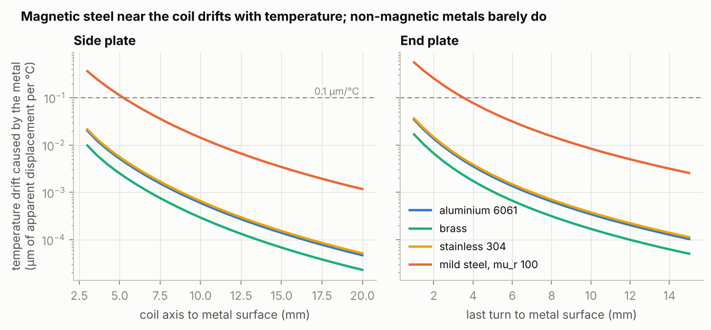
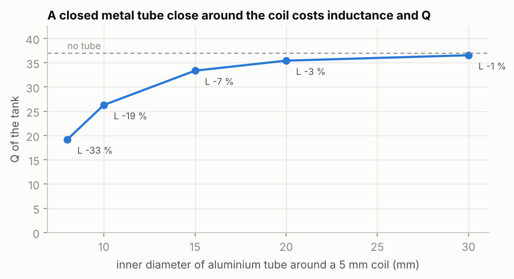

# Metal near the coil

**Project version:** 0.3.0
**Reproduce:** `python tools/nearby_metal.py` (raw output in `docs/nearby-metal-results.txt`)
**Coil analysed:** 32 turns of 30 AWG on 5 mm, 10 mm long, ringing at 1.74 MHz, mid-range

Model results; nothing here has been measured.

## Summary

1. **Metal anywhere within a few coil diameters shifts the reading by tens to hundreds
   of microns.** The shift is fixed if the metal is fixed, so calibrating the sensor in
   place absorbs it. Calibrating on the bench and then installing next to metal does not.
2. **What cannot be calibrated out is relative movement.** If the coil can shift
   0.1 mm sideways in its guide, a metal surface 5 mm from the coil axis turns that
   into about 7 µm of error. At 10 mm it is under 1 µm.
3. **Non-magnetic metals do not drift with temperature. Mild steel does**: about
   0.1 µm/°C at 5 mm, and its permeability also changes with stress, which this model
   cannot predict.
4. **Keep-out rule:** 10 mm from the coil axis to any metal surface alongside, 7.5 mm
   beyond each end, and prefer aluminium, brass or austenitic stainless to mild steel.
   That is two coil diameters, the upper end of the earlier one-to-two-diameter guess.
5. **A closed metal tube around the coil needs an inner diameter of four coil
   diameters** before its cost is small. A metal screw must not enter the coil.

## How it is modelled

A conductor in the coil's field carries eddy currents that oppose the field. The coil
sees lower inductance and extra loss.

- **Thick plates: image method.** The plate is replaced by a mirror-image coil. Finite
  conductivity and permeability move the image back by a complex distance
  μr·δ·(1 − j), where δ is the skin depth; the real part reduces the effect and the
  imaginary part is the loss.
- **Tubes, rods, washers: shorted rings.** The metal is cut into coaxial rings, each
  coupled to every turn of the coil and to every other ring, and the coupled circuit
  is solved. Non-magnetic metals only.

The two methods were run on the same case, an aluminium plate facing the coil end:

| Gap | Inductance change, image | Inductance change, rings | Added resistance, image | rings |
|---|---|---|---|---|
| 2 mm | −2.31 % | −2.33 % | 9.9 mΩ | 10.0 mΩ |
| 5 mm | −0.617 % | −0.618 % | 1.6 mΩ | 1.6 mΩ |
| 10 mm | −0.165 % | −0.160 % | 0.26 mΩ | 0.28 mΩ |

They agree within 3 % on inductance. Skin depths at 1.74 MHz: aluminium 76 µm, brass
97 µm, stainless 304 324 µm, mild steel about 15 µm (taking μr = 100).

## Coil alongside a metal surface

Distance is from the coil axis to the surface; the coil's own radius is 2.5 mm.

| Metal | Distance | Offset | Per 0.1 mm of relative movement | Drift | Q (37 with no metal) |
|---|---|---|---|---|---|
| Aluminium | 3 mm | 432 µm | 25 µm | 0.02 µm/°C | 35 |
| | 5 mm | 159 µm | 6.6 µm | 0.005 µm/°C | 36 |
| | 10 mm | 30 µm | 0.8 µm | 0.001 µm/°C | 37 |
| | 20 mm | 4 µm | 0.06 µm | negligible | 37 |
| Stainless 304 | 5 mm | 151 µm | 6.2 µm | 0.006 µm/°C | 36 |
| | 10 mm | 29 µm | 0.8 µm | 0.001 µm/°C | 37 |
| Mild steel | 3 mm | 260 µm | 12 µm | 0.36 µm/°C | 28 |
| | 5 mm | 112 µm | 4.1 µm | 0.11 µm/°C | 34 |
| | 10 mm | 24 µm | 0.6 µm | 0.014 µm/°C | 37 |
| | 20 mm | 4 µm | 0.05 µm | 0.001 µm/°C | 37 |

Brass behaves like aluminium to within a percent.

"Offset" is what an uncalibrated sensor would misread. "Per 0.1 mm" is the error when
the gap between coil and metal changes by a tenth of a millimetre: a coil with 0.5 mm
of bore clearance can move ±0.25 mm in its guide, which at 5 mm from aluminium is
±16 µm and at 10 mm is ±2 µm.

## Metal facing the end of the coil

Distance is from the last turn to the surface.

| Metal | Distance | Offset | Per 0.1 mm of relative movement | Drift | Q |
|---|---|---|---|---|---|
| Aluminium | 1 mm | 594 µm | 42 µm | 0.03 µm/°C | 34 |
| | 3 mm | 183 µm | 8.3 µm | 0.006 µm/°C | 36 |
| | 5 mm | 83 µm | 2.8 µm | 0.002 µm/°C | 37 |
| | 7.5 mm | 39 µm | 1.0 µm | 0.001 µm/°C | 37 |
| | 10 mm | 22 µm | 0.5 µm | negligible | 37 |
| Mild steel | 1 mm | 310 µm | 16 µm | 0.55 µm/°C | 25 |
| | 3 mm | 124 µm | 4.7 µm | 0.13 µm/°C | 33 |
| | 5 mm | 63 µm | 1.9 µm | 0.05 µm/°C | 35 |
| | 10 mm | 19 µm | 0.4 µm | 0.008 µm/°C | 37 |

An anchor that moves with the last turn keeps a constant gap to it, so its effect is a
repeatable part of the calibration curve. A plate the moving end approaches is not
constant gap: its effect grows through the stroke and adds to the nonlinearity, still
repeatably.

## Why mild steel is the one to avoid

Steel is both conductive and magnetic, and the two pull in opposite directions: eddy
currents lower the coil's inductance, permeability raises it. At 1.7 MHz eddy currents
win, but the balance depends on the product μr·δ, about 1.5 mm, which moves with
anything that changes resistivity or permeability.

| Assumed μr | Distance | Offset | Error per 1 % change in μr |
|---|---|---|---|
| 50 | 5 mm | 126 µm | 0.17 µm |
| 100 | 5 mm | 112 µm | 0.23 µm |
| 200 | 5 mm | 94 µm | 0.28 µm |
| 100 | 10 mm | 24 µm | 0.03 µm |

- The drift figures above come from resistivity alone (0.5 %/°C). Permeability has its
  own temperature dependence, not included.
- Permeability of steel changes with mechanical stress. A steel member whose strain is
  being measured changes its own permeability as it is loaded, which would appear as a
  reading correlated with load. The size is not known here; at 10 mm a 1 % change is
  worth only 0.03 µm, so distance is the defence.
- The value of μr at this frequency is uncertain by a factor of two either way, and the
  image approximation is rough for steel closer than about 5 mm. Treat the steel rows
  as estimates.

This matters for the soft-robotics specification, which chose steel for the anchored
member because of its low thermal expansion. That choice stands, provided the coil
sits 10 mm or more from it or is calibrated in place and kept from moving sideways.

## Coaxial metal: tubes, screws, washers

| Case | Inductance | Sensitivity | Drift | Q |
|---|---|---|---|---|
| Aluminium tube, 8 mm inner diameter | −33 % | −28 % | 0.16 µm/°C | 19 |
| Aluminium tube, 10 mm | −19 % | −14 % | 0.08 µm/°C | 26 |
| Aluminium tube, 15 mm | −7 % | −3 % | 0.02 µm/°C | 33 |
| Aluminium tube, 20 mm | −3 % | −1 % | 0.007 µm/°C | 35 |
| Aluminium tube, 30 mm | −1 % | −0.2 % | 0.001 µm/°C | 37 |
| Stainless tube, 10 mm, 0.5 mm wall | −18 % | −13 % | 0.09 µm/°C | 20 |
| Brass M3 screw on axis, tip 1 mm outside the coil end | −0.5 % | −0.9 % | 0.007 µm/°C | 36 |
| Brass M3 screw, tip 3 mm outside | −0.1 % | −0.2 % | 0.001 µm/°C | 37 |
| Brass M3 screw reaching 3 mm into the coil | −10 % | −21 % | 0.09 µm/°C | 25 |
| Brass washer 1 mm beyond the coil end | −2.7 % | −4.6 % | 0.02 µm/°C | 33 |
| Brass washer 3 mm beyond | −0.4 % | −0.7 % | 0.004 µm/°C | 36 |

- **A metal guide tube is a poor idea.** At 8 mm bore it takes a third of the
  inductance, a quarter of the sensitivity and half the Q. A stainless tube is no
  better: it is resistive enough to cost as much Q as aluminium costs at a smaller bore.
- **A shield needs room.** At four coil diameters (20 mm) a closed aluminium tube costs
  3 % of inductance and 1 % of sensitivity, which is an acceptable price for
  interference shielding. A lengthwise slit stops the circulating current and should
  remove most of the effect; that case is not modelled.
- **Fasteners belong outside the coil.** A brass screw ending 3 mm short of the last
  turn is invisible. The same screw 3 mm inside the coil costs a fifth of the
  sensitivity. Steel screws are not modelled; assume they are worse.

## Keep-out distances

| Requirement at mid-range | Alongside (axis to surface) | Beyond the end (last turn to surface) |
|---|---|---|
| Under 1 µm per 0.1 mm of relative movement | 10 mm, any metal | 7.5 mm, any metal |
| Drift under 0.1 µm/°C, non-magnetic metal | 3 mm | 1 mm |
| Drift under 0.1 µm/°C, mild steel | 7.5 mm | 5 mm |
| Q loss under 10 % | 3 to 5 mm | 1 to 5 mm |

Distances scale with coil diameter. For a coil of another size, rerun the script
instead of scaling these by eye, because skin depth does not scale with it.

The one published measurement found for comparison is in line with these: a steel rod
beside a much larger braided-wire sensor biased it by 0.1 to 0.3 mm on average
(Felt et al., in `literature-review.md`).

## Limits

- Plates are treated as infinite and thicker than a few skin depths. Foil thinner than
  about 0.1 mm in aluminium is not covered by the image model.
- Steel uses an assumed μr and an approximation that weakens under 5 mm.
- Ferrite, steel tubes and steel screws are not modelled. A finite-element tool such as
  FEMM would cover them.
- Loss figures assume a coil Q of 37 with no metal, taken from the notebook model.
