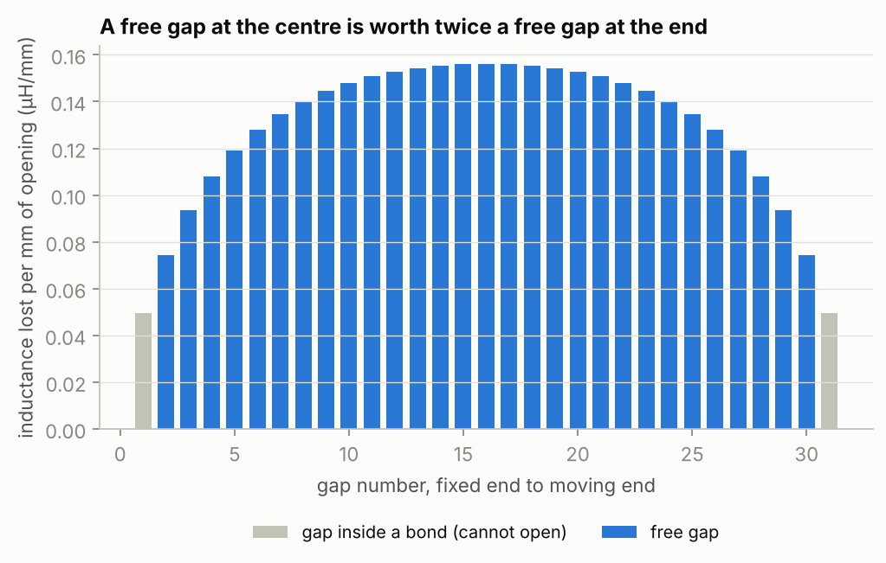
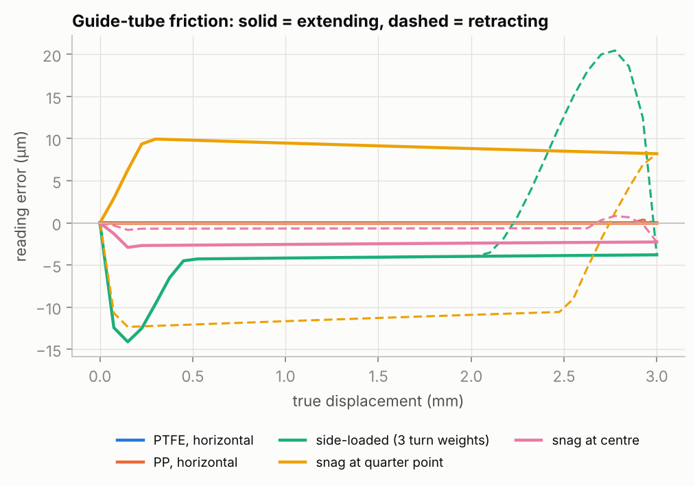
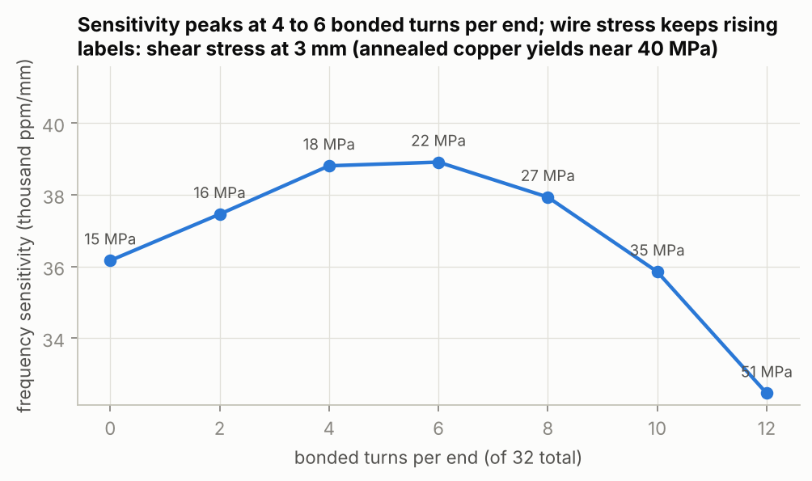

# What happens when the coil does not stretch evenly

**Project version:** 0.2.0
**Reproduce:** `python tools/nonuniform_stretch.py` (raw output in
`docs/nonuniform-stretch-results.txt`)
**Coil analysed:** 32 turns of 30 AWG on 5 mm, 2 bonded turns per end, 0 to 3 mm, 4700 pF tank

These are model results. Nothing here has been measured on a real coil yet.

## Summary

The sensor reads inductance, and inductance depends on where every turn sits, not only
on the distance between the two ends. Three consequences:

1. **Gaps near the centre of the coil carry about twice the signal of gaps near the ends.**
   Any shift of stretch between centre and ends changes the reading at constant length.
2. **A fixed unevenness is harmless; a changing one is an error.** A coil wound with
   irregular pitch reads differently from the ideal one, but identically every cycle, so
   calibration absorbs it. What hurts is a distribution that differs between extending
   and retracting, or from one day to the next.
3. **For this design the realistic error is small with a free coil and about 20 µm with a
   snag or side load.** That is 20 to 40 times the electrical resolution target, so the
   guide tube, not the circuit, decides whether the sensor reaches a micron.

## 1. Which gaps matter

Opening one gap by a small amount separates every turn on its left from every turn on
its right. A centre gap splits the coil into two halves of 16 turns that were strongly
coupled; an end gap only moves a few turns away from the rest. The first free gap is
worth 48 % of the centre gap, and a gap a quarter of the way in is worth 90 %.

## 2. Same length, different distribution

Each row holds the end-to-end displacement fixed and rearranges where the stretch goes.
The error is how far the reading would be from the truth if the sensor had been
calibrated with an evenly stretched coil. Negative means the sensor reads short.

| Distribution of the stretch | at 0.5 mm | at 1.5 mm | at 3.0 mm |
|---|---|---|---|
| Linear gradient, ±10 % end to end | −0.1 µm | −0.4 µm | −1.6 µm |
| Linear gradient, ±30 % | −0.5 µm | −3.8 µm | −14 µm |
| Linear gradient, ±100 % (one end closed, other double) | −5 µm | −43 µm | −162 µm |
| Only the moving-end half opens | −11 µm | −116 µm | −458 µm |
| Only the centre half opens | +62 µm | +108 µm | +7 µm |
| Only the two end quarters open | −92 µm | −340 µm | −861 µm |
| One centre gap takes everything | −4 µm | −373 µm | −1491 µm |
| Random, 10 % rms per gap, re-drawn each time | 1.9 µm rms | 5.0 µm rms | 9.2 µm rms |
| Random, 30 % rms per gap, re-drawn each time | 5.1 µm rms | 15 µm rms | 29 µm rms |

Reading the table:

- A smooth gradient costs little because the coil is symmetric: what the stiff end loses
  the soft end regains, and only a second-order term remains. A ±10 % gradient is worth
  about a micron.
- Concentrating stretch in a few gaps is costly at large displacement, because a wide
  gap has already lost most of its coupling and opening it further does little.
- The random rows are the useful bound on repeatability. If the way the stretch divides
  among the gaps varies by 10 % from cycle to cycle, expect 2 to 9 µm of scatter.

## 3. Friction in the guide tube

Each free turn is modelled as a mass-less node between two springs, with Coulomb
friction against the tube. The moving end is stepped 0 → 3 mm → 0 and the turns settle
at each step. One turn weighs 70 µN, so with a horizontal coil resting on the tube the
friction per turn is the friction coefficient times 70 µN.

| Case | Largest error | Extend vs retract difference |
|---|---|---|
| PTFE tube, horizontal (µ ≈ 0.1) | < 0.01 µm | < 0.01 µm |
| Polypropylene tube, horizontal (µ ≈ 0.3) | 0.4 µm | 0.4 µm |
| Side-loaded: normal force 3× turn weight at µ = 1, or 10× at µ = 0.3 | 20 µm | 24 µm |
| PTFE, plus one turn snagged a quarter of the way along (2 mN to break free) | 12 µm | 22 µm |
| PTFE, plus one turn snagged at the centre (2 mN) | 2.9 µm | 3.1 µm |

Why uniform friction does so little: it produces a gradient of tension along the coil,
steeper toward the moving end when extending and reversed when retracting. The two
states are mirror images, and a symmetric coil has the same inductance in both. The
error appears only during the reversal, while the gradient is flipping, and it scales
with the square of the friction.

Why a snag is worse: it breaks the symmetry. A snag at the quarter point holds back
three quarters of the coil on one stroke and one quarter on the other, and those two
portions contain different shares of the high-value centre gaps. The same snag at the
exact centre nearly cancels.

Limits of this model: quasi-static, no turn inertia, no tilt or bowing of turns, friction
independent of position, and no initial tension between close-wound turns. The 2 mN
snag force is a guess at what a burr or adhesive fillet might do. Treat the numbers as
orders of magnitude until a real coil has been swept on a micrometer stage.

## 4. Using uneven stretch on purpose

Since centre gaps are worth more, a coil that puts its stretch in the centre should be
more sensitive. It is, but only slightly, and it costs wire stress.

| Design (32 turns, 30 AWG) | L compressed | Sensitivity at 1.5 mm | Force at 3 mm | Shear at 3 mm |
|---|---|---|---|---|
| No bonded turns | 2.01 µH | 36,200 ppm/mm | 18 mN | 15 MPa |
| 2 bonded per end (current design) | 2.01 µH | 37,500 ppm/mm | 19 mN | 16 MPa |
| 4 bonded per end | 2.01 µH | 38,800 ppm/mm | 22 mN | 18 MPa |
| 6 bonded per end | 2.01 µH | 38,900 ppm/mm | 26 mN | 22 MPa |
| 8 bonded per end | 2.01 µH | 37,900 ppm/mm | 33 mN | 27 MPa |
| 12 bonded per end | 2.01 µH | 32,500 ppm/mm | 62 mN | 51 MPa (over yield) |
| Ends wound at 4 mm, centre at 5 mm (8+16+8 turns) | 1.67 µH | 39,000 ppm/mm | 25 mN | 20 MPa |
| 14 centre gaps pre-opened to 2× pitch | 1.51 µH | 27,400 ppm/mm | 19 mN | 16 MPa |
| 14 end gaps pre-opened to 2× pitch | 1.61 µH | 31,000 ppm/mm | 19 mN | 16 MPa |

Findings:

- **Bonding more end turns buys at most 4 % sensitivity**, peaking at 4 to 6 turns per
  end. Beyond that the remaining free gaps open so far that they lose value, and stress
  climbs steeply. The practical message runs the other way: the bond length is not
  critical for sensitivity, so choose it for mechanical reasons, and keep it short
  enough that stress stays comfortable.
- **A two-diameter coil** (stiffer small-diameter ends, softer centre) does the same job
  without adhesive on the active turns and gains about 4 %. Not worth the winding
  complexity for sensitivity alone.
- **Pre-opened pitch always loses sensitivity.** Per-turn spring stiffness does not
  depend on pitch, so every free gap opens by the same amount wherever it starts, and a
  gap that starts open has less coupling left to lose. Series sections of different
  turn spacing reduce sensitivity by 17 to 27 % in these examples. Wind close.
- Close-wound and even is very nearly the best this geometry can do. The lever that
  matters for sensitivity is coil length (shorter is better), not turn distribution.

## What to do about it

1. Keep the coil free: clearance in the bore, no side load, no adhesive past the bonded
   turns, smooth tube ends.
2. Keep the coil symmetric: equal bond lengths at both ends. The cancellation of uniform
   friction depends on it.
3. Calibrate against a polynomial on the assembled sensor, extending and retracting, and
   record the difference. That single test measures everything in section 3.
4. If hysteresis is found, look for a snag before changing the electronics.
5. Mount horizontal coils so they rest on the tube rather than hang in a bow, or mount
   them vertically, where the coil's weight adds a fixed gradient that calibrates out.
