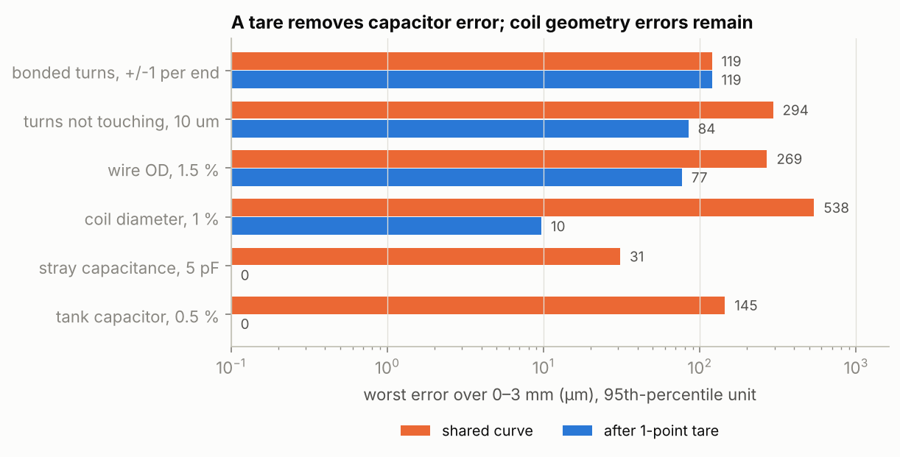
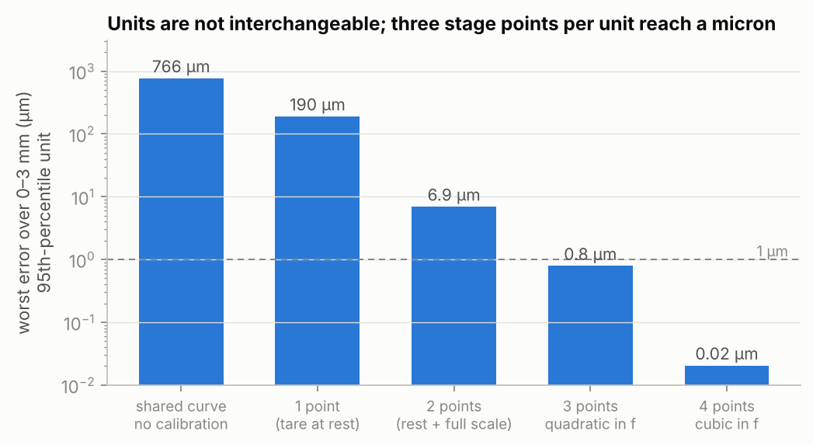

# Build tolerances and calibration

**Project version:** 0.3.0
**Reproduce:** `python tools/tolerance_mc.py` (raw output in `docs/tolerance-results.txt`)
**Coil analysed:** 32 turns of 30 AWG on 5 mm, 2 bonded turns per end, 0 to 3 mm, 4700 pF tank

These are model results from 2,000 simulated builds. The tolerances are assumptions
about hand winding, not measurements; edit the `TOL` block in the script once real
coils have been measured.

## Summary

1. **Two sensors built to the same recipe are not interchangeable.** Read against one
   shared curve, a typical unit is wrong by 0.3 mm and a poor one by 0.8 mm.
2. **Three known positions per unit reach a micron.** Fit displacement as a quadratic
   in frequency. Four positions and a cubic leave nothing measurable.
3. **Calibrate in frequency, not in inductance.** Displacement is a much smoother
   function of f than of 1/f².
4. **After that, the position reference is the limit.** A stage good to ±2 µm gives a
   sensor good to about ±5 µm, however many points are taken.
5. **A reference coil cancels temperature to well under 0.1 µm/°C** if its capacitor
   comes from the same reel and it sits at the same temperature as the sensor.

## 1. How far apart are the units

Assumed build tolerances (one standard deviation): coil diameter 1 %, wire diameter
over enamel 1.5 %, 10 µm of extra gap per turn at rest, bonded turns 2 ± 1 at each end,
tank capacitor 0.5 %, stray capacitance 5 pF.

| Quantity | Median | 95 % of units within |
|---|---|---|
| Rest frequency | 1.651 MHz | ±2.2 % |
| Inductance at rest | 1.97 µH | ±4.4 % |
| Frequency span over 3 mm | 11.7 % | ±4.1 % of that |
| Sensitivity at 1.5 mm | 36,500 ppm/mm | ±3.8 % |

## 2. Which tolerance is responsible

Each bar varies one tolerance alone. A tare (reading the unit at rest and scaling the
shared curve to match) removes capacitor and stray-capacitance errors completely,
because those shift the whole curve by a constant factor. It removes most of the
diameter error. It does nothing for the number of bonded turns, which changes the
shape of the curve without changing the rest frequency, and little for loose winding.

So the capacitor does not need to be a tight-tolerance part. Its stability matters;
its value does not.

## 3. How much calibration a unit needs

| Method | Median unit | 95th-percentile unit |
|---|---|---|
| Shared curve, nothing per unit | 301 µm | 766 µm |
| One point: tare at rest | 84 µm | 190 µm |
| Two points: rest and full scale, shared curve shape | 3.0 µm | 6.9 µm |
| Three points, quadratic in f | 0.6 µm | 0.8 µm |
| Four points, cubic in f | 0.01 µm | 0.02 µm |
| Three points, quadratic in 1 − (f₀/f)² | 9.7 µm | 11 µm |
| Four points, cubic in 1 − (f₀/f)² | 0.7 µm | 0.9 µm |

Errors are the largest over the 0 to 3 mm range, with perfect knowledge of the
calibration positions.

Two results are worth using:

- **The two-point method is a good field calibration.** Rest plus one gauge block at
  full scale, with the curve shape taken from the model, is good to about 7 µm with no
  stage at all.
- **Fit in frequency.** The same data fitted against a variable proportional to
  inductance needs one more polynomial order for the same accuracy.

### The stage sets the floor

With calibration positions known only to ±2 µm (one standard deviation):

| Fit | Points | Worst error, 95th percentile | RMS over range |
|---|---|---|---|
| Cubic | 4 | 5.5 µm | 2.0 µm |
| Cubic | 7 | 4.6 µm | 1.4 µm |
| Cubic | 13 | 3.8 µm | 1.1 µm |
| Quartic | 25 | 3.8 µm | 0.9 µm |

More points help slowly. A sensor cannot be calibrated to better than the thing it is
calibrated against, so sub-micron accuracy needs a sub-micron reference (gauge blocks
or a capacitive or interferometric stage), whatever the electronics resolve.

## 4. What a reference coil leaves uncancelled

A second coil held at fixed length, with its own capacitor, measured as a ratio.

| Residual | In frequency | As displacement |
|---|---|---|
| Coil growth: sensor stretched 3 mm, reference at rest | 0.3 ppm/°C | 0.008 µm/°C |
| Capacitor tempco mismatch, same reel (assumed 5 ppm/°C) | 2.5 ppm/°C | 0.07 µm/°C |
| Capacitor tempco mismatch, different lots (up to 30 ppm/°C) | 15 ppm/°C | 0.41 µm/°C |
| Sensor and reference at different temperatures | 31 ppm per °C of difference | 0.84 µm per °C of difference |
| Microcontroller clock | cancels exactly | 0 |

The reference coil does not need to match the sensor's stretch: the thermal growth of
a copper coil affects stretched and unstretched coils almost equally. What it needs is
a capacitor from the same reel and the same temperature. One degree of difference
between the two coils costs more than everything else in the table.

The 5 ppm/°C same-reel figure is an assumption. Measuring it takes one oven run.

## A calibration recipe

1. Install the sensor where it will be used, with everything nearby in place (see
   `nearby-metal.md`).
2. Record frequency at rest and at three or more known positions, extending and then
   retracting. The up/down difference is the hysteresis.
3. Fit displacement as a quadratic or cubic in f/f₀ − 1, where f₀ is the rest
   frequency. If a reference coil is fitted, use the sensor/reference ratio in place of f.
4. In the field with no stage: rest and one gauge block, with the shape from the model.

## Limits

- Tolerances are assumed. Bond length in particular is a guess and is the largest
  contributor after a tare.
- Every simulated unit stretches evenly and without hysteresis. Real errors from
  `nonuniform-stretch.md` add to these.
- Calibration does not transfer if the surroundings change: see `nearby-metal.md`.
